# Evidências da atividade Docker Compose

Projeto: Achados & Perdidos (Flask + PostgreSQL + Gunicorn)
Ambiente: macOS (MacBook Air), Docker Desktop, terminal e VS Code
Coleta: 19 de outubro de 2026

As capturas estão nesta pasta e seguem a ordem em que os testes foram
executados. Cada seção traz a imagem, o comando que aparece nela e o que a
saída registra.

## 1. Subida do ambiente (01-ps.png)

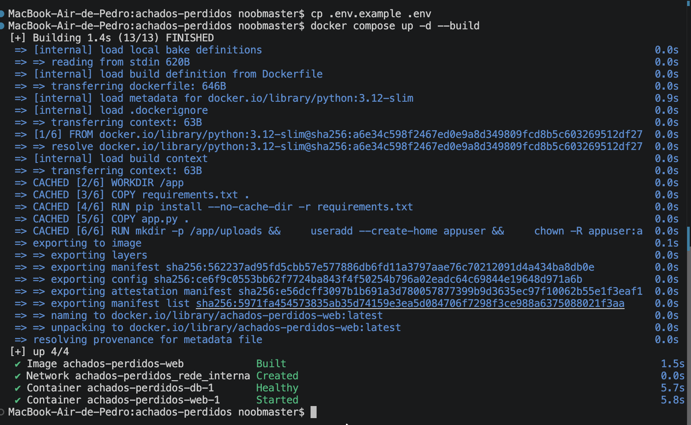

O terminal está na raiz do projeto. O primeiro comando copia o modelo de
variáveis (`cp .env.example .env`) e o segundo constrói e sobe o ambiente
(`docker compose up -d --build`). O build levou 1,4 s e as etapas de instrução
(2/6 a 6/6) vieram do cache, inclusive o `pip install`; só a leitura dos
metadados da imagem base gastou tempo (0,9 s).

No resumo `up 4/4`, a imagem foi construída, a rede foi criada, o contêiner
`achados-perdidos-db-1` ficou `Healthy` e o `achados-perdidos-web-1` iniciou
logo depois. Essa ordem vem do `depends_on` com `condition: service_healthy`,
que segura o web até o Postgres responder.

## 2. Health check (02-health.png)

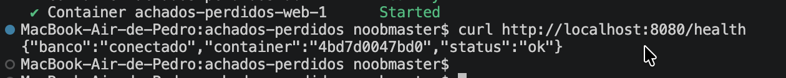

```console
$ curl http://localhost:8080/health
{"banco":"conectado","container":"4bd7d0047bd0","status":"ok"}
```

O endpoint abre uma conexão com o Postgres e executa `SELECT 1` antes de
responder. Por isso `status: ok` e `banco: conectado` confirmam o caminho entre
o Flask e o banco pela rede interna. O campo `container` é o hostname do
contêiner e muda quando ele é recriado.

## 3. Listagem e filtro (03-itens.png)

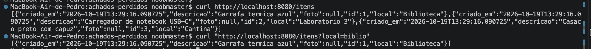

```console
$ curl http://localhost:8080/itens
[{"criado_em":"2026-10-19T13:29:16.090725","descricao":"Garrafa termica azul","foto":null,"id":1,"local":"Biblioteca"}, ...]

$ curl "http://localhost:8080/itens?local=biblio"
[{"criado_em":"2026-10-19T13:29:16.090725","descricao":"Garrafa termica azul","foto":null,"id":1,"local":"Biblioteca"}]
```

Os três registros iniciais vêm de `db/init.sql`: Garrafa termica azul
(Biblioteca), Carregador de notebook USB-C (Laboratorio 3) e Casaco preto com
capuz (Cantina). Todos têm `foto: null` e o mesmo `criado_em`, o horário em que
o banco foi inicializado.

O segundo comando aplica o filtro `local`, que no código vira um
`ILIKE %biblio%`, e devolve apenas o item da Biblioteca. A consulta é resolvida
no banco, não na aplicação.

## 4. Cadastro com foto (04-cadastro.png)

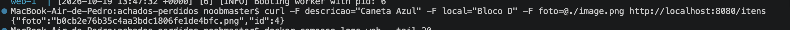

```console
$ curl -F descricao="Caneta Azul" -F local="Bloco D" -F foto=@./image.png http://localhost:8080/itens
{"foto":"b0cb2e76b35c4aa3bdc1806fe1de4bfc.png","id":4}
```

O `-F` envia o formulário como `multipart/form-data`, formato que o Flask lê em
`request.form` e `request.files`. O servidor gravou o arquivo com um nome UUID e
a extensão original, e devolveu o id 4, o próximo depois dos três itens do
`init.sql`. O nome original (`image.png`) não é reaproveitado no armazenamento,
o que evita colisão entre arquivos de mesmo nome.

## 5. Foto servida de volta (04-foto-navegador.png)

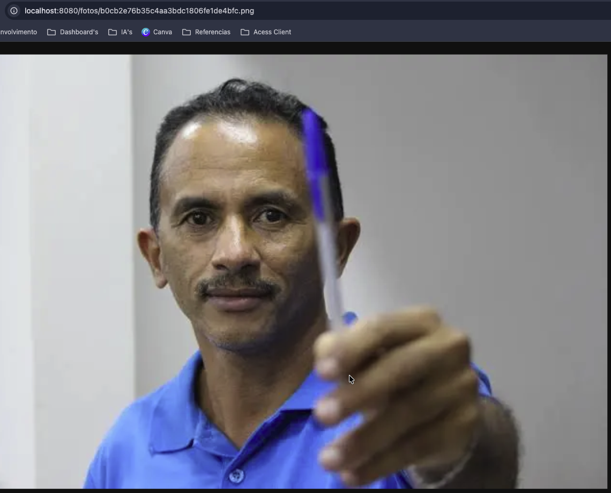

A barra de endereço mostra
`localhost:8080/fotos/b0cb2e76b35c4aa3bdc1806fe1de4bfc.png`, exatamente o
caminho devolvido pelo cadastro anterior. A imagem exibida é a mesma `image.png`
enviada no `curl`: um homem de camisa azul segurando uma caneta.

O Flask serve o arquivo com `send_from_directory` a partir de `/app/uploads`,
então a captura fecha o ciclo entre o upload, o volume e o download.

## 6. Estatísticas (05-estatisticas.png)

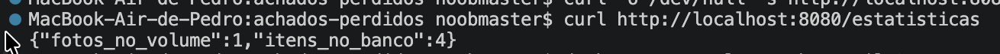

```console
$ curl http://localhost:8080/estatisticas
{"fotos_no_volume":1,"itens_no_banco":4}
```

Os dois números vêm de fontes diferentes: `itens_no_banco` é um `COUNT(*)` na
tabela `itens` e `fotos_no_volume` é um `os.listdir` em `/app/uploads`. O 4 e o
1 correspondem ao que foi feito nas seções 3 e 4, então o registro e o arquivo
chegaram aos dois locais.

## 7. Logs do Gunicorn (06-logs.png)

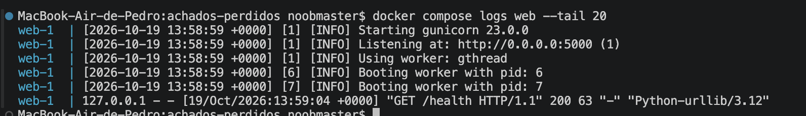

```console
$ docker compose logs web --tail 20
web-1 | [2026-10-19 13:58:59 +0000] [1] [INFO] Starting gunicorn 23.0.0
web-1 | [2026-10-19 13:58:59 +0000] [1] [INFO] Listening at: http://0.0.0.0:5000 (1)
web-1 | [2026-10-19 13:58:59 +0000] [1] [INFO] Using worker: gthread
web-1 | [2026-10-19 13:58:59 +0000] [6] [INFO] Booting worker with pid: 6
web-1 | [2026-10-19 13:58:59 +0000] [7] [INFO] Booting worker with pid: 7
web-1 | 127.0.0.1 - - [19/Oct/2026:13:59:04 +0000] "GET /health HTTP/1.1" 200 63 "-" "Python-urllib/3.12"
```

O log mostra o worker `gthread`, dois processos (pids 6 e 7) e o log de acesso
ativo. A linha de acesso é o health check do compose, que usa `urllib` do
Python, e retornou 200 com 63 bytes.

A configuração substituiu o worker `sync`, que travava quando uma conexão abria
o socket e não enviava requisição: o master matava o worker depois do timeout e
registrava um traceback de `WORKER TIMEOUT`. Com `gthread`, uma conexão parada
ocupa uma thread e a aplicação continua atendendo as outras.

## 8. Estado antes de derrubar (07-antes.png)

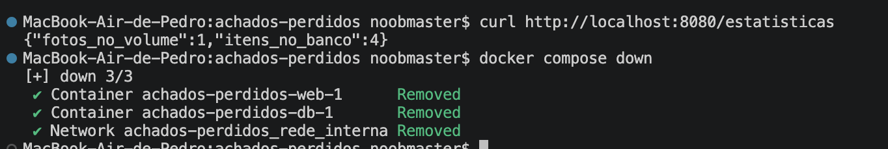

```console
$ curl http://localhost:8080/estatisticas
{"fotos_no_volume":1,"itens_no_banco":4}

$ docker compose down
[+] down 3/3
 ✔ Container achados-perdidos-web-1      Removed
 ✔ Container achados-perdidos-db-1       Removed
 ✔ Network achados-perdidos_rede_interna Removed
```

A captura fixa o estado que será comparado depois: 1 foto e 4 itens. O `down`
remove os dois contêineres e a rede, mas não lista nenhum volume, diferença que
a próxima seção testa.

## 9. Persistência com down e up (08-down-up.png e 08-depois.png)

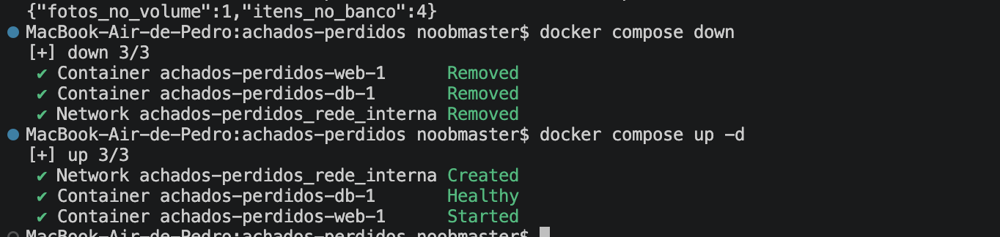

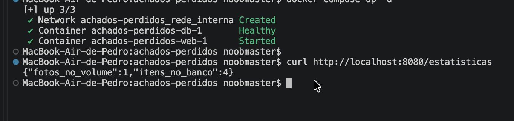

O primeiro arquivo mostra `docker compose down` (3/3) e `docker compose up -d`
(3/3: rede criada, banco `Healthy`, web `Started`). O segundo mostra a mesma
subida e, logo depois, `/estatisticas` devolvendo
`{"fotos_no_volume":1,"itens_no_banco":4}`.

Os contêineres foram recriados, mas os volumes não foram tocados. O banco
encontrou a tabela já populada e o diretório de uploads manteve o arquivo. Os
números são os mesmos da seção 8, o que caracteriza persistência entre
execuções.

## 10. Volumes (09-volumes.png)

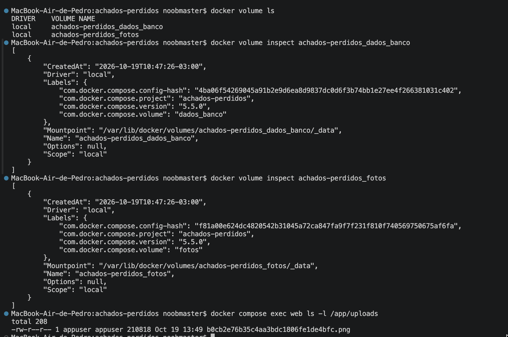

```console
$ docker volume ls
DRIVER    VOLUME NAME
local     achados-perdidos_dados_banco
local     achados-perdidos_fotos

$ docker volume inspect achados-perdidos_dados_banco
... "Mountpoint": "/var/lib/docker/volumes/achados-perdidos_dados_banco/_data" ...

$ docker compose exec web ls -l /app/uploads
-rw-r--r-- 1 appuser appuser 210818 Oct 19 13:49 b0cb2e76b35c4aa3bdc1806fe1de4bfc.png
```

Os dois volumes nomeados aparecem com o prefixo do projeto (`achados-perdidos_`)
e as labels do compose (`project`, `volume`, `config-hash`). O `inspect` do
volume `fotos` mostra o mesmo formato de saída, com o mountpoint
`/var/lib/docker/volumes/achados-perdidos_fotos/_data`.

O `ls` dentro do contêiner web mostra o arquivo de 210.818 bytes com dono
`appuser`, o usuário sem privilégios criado no Dockerfile. Isso mostra que o
upload da seção 4 está no volume `fotos`, não na camada gravável do contêiner.

## 11. Remoção dos volumes (10-remocao-volumes.png)

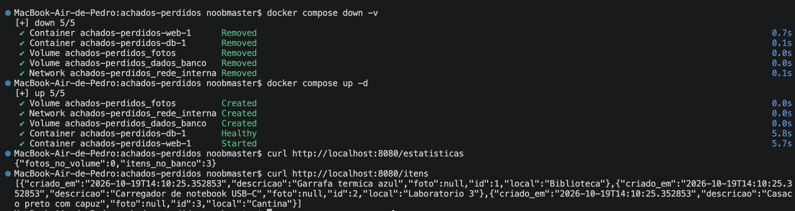

```console
$ docker compose down -v
[+] down 5/5
 ✔ Container achados-perdidos-web-1      Removed
 ✔ Container achados-perdidos-db-1       Removed
 ✔ Volume achados-perdidos_fotos         Removed
 ✔ Volume achados-perdidos_dados_banco   Removed
 ✔ Network achados-perdidos_rede_interna Removed

$ docker compose up -d
[+] up 5/5
 ✔ Volume achados-perdidos_fotos         Created
 ✔ Network achados-perdidos_rede_interna Created
 ✔ Volume achados-perdidos_dados_banco   Created
 ✔ Container achados-perdidos-db-1       Healthy
 ✔ Container achados-perdidos-web-1      Started

$ curl http://localhost:8080/estatisticas
{"fotos_no_volume":0,"itens_no_banco":3}
```

Agora o `down -v` remove os dois volumes além dos contêineres e da rede (5/5).
No `up` seguinte, os volumes são criados vazios e o `init.sql` roda de novo. É o
que explica o `criado_em` 14:10:25 na listagem seguinte e o contador de fotos
em 0. Comparado à seção 9, fica claro o papel do `-v`: sem
ele os dados sobrevivem, com ele o ambiente volta ao estado inicial.

## 12. Rede interna (11-rede.png)

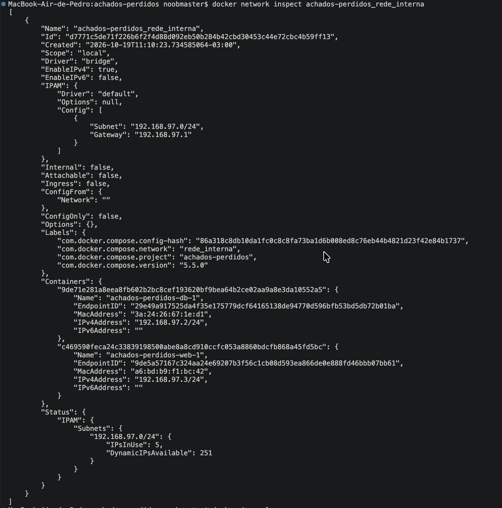

```console
$ docker network inspect achados-perdidos_rede_interna
"Driver": "bridge",
"Subnet": "192.168.97.0/24",
"Gateway": "192.168.97.1",
"Internal": false,
...
"Containers": {
  "achados-perdidos-db-1":  { "IPv4Address": "192.168.97.2/24" },
  "achados-perdidos-web-1": { "IPv4Address": "192.168.97.3/24" }
}
```

A rede do compose é uma bridge na sub-rede 192.168.97.0/24. O banco ficou no
endereço .2 e o web no .3. O Flask usa o hostname `db`, que o DNS interno do
Docker resolve para 192.168.97.2.

O campo `Internal: false` indica que a rede tem saída para fora. O banco não
publica porta no host (seção 1), então só é alcançável por essa rede. A rede em
si é uma bridge comum; o isolamento está na falta de mapeamento de porta.

## 13. Imagens (12-imagens.png)

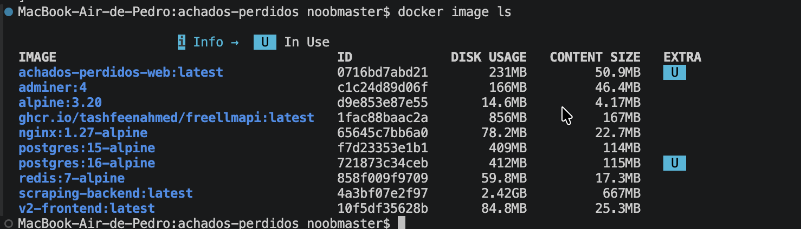

```console
$ docker image ls
IMAGE                        ID             DISK USAGE   CONTENT SIZE   EXTRA
achados-perdidos-web:latest  0716bd7abd21   231MB        50.9MB         U
postgres:16-alpine           721873c34ceb   412MB        115MB          U
```

A imagem `achados-perdidos-web:latest` é a construída localmente pelo
Dockerfile, com 50,9 MB de conteúdo. A `postgres:16-alpine` é a oficial usada
pelo serviço de banco. As duas aparecem com o marcador `U` (*in use*).

A listagem é global da máquina. Além dessas, aparecem imagens usadas nos bônus
(`adminer:4`, `nginx:1.27-alpine`) e outras imagens da máquina
(`redis:7-alpine`, `scraping-backend:latest`, `alpine:3.20`).

## 14. Adminer (13-adminer.png)

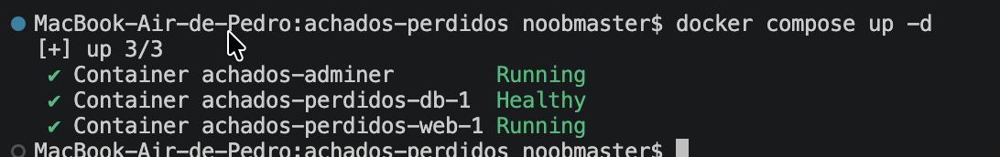

```console
$ docker compose up -d
[+] up 3/3
 ✔ Container achados-adminer        Running
 ✔ Container achados-perdidos-db-1  Healthy
 ✔ Container achados-perdidos-web-1 Running
```

A captura registra o contêiner do Adminer em execução ao lado do banco e da
aplicação. O nome sem o sufixo `-1` indica que o serviço define
`container_name`.

A tela de login do Adminer não está neste arquivo; o que ela registra é a
subida do serviço.

## 15. Backup (14-backup.png)

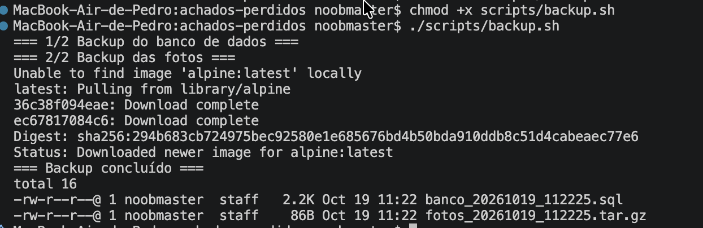

```console
$ chmod +x scripts/backup.sh
$ ./scripts/backup.sh
=== 1/2 Backup do banco de dados ===
=== 2/2 Backup das fotos ===
...
=== Backup concluído ===

total 16
-rw-r--r--@  1 noobmaster  staff   2.2K Oct 19 11:22 banco_20261019_112225.sql
-rw-r--r--@  1 noobmaster  staff    86B Oct 19 11:22 fotos_20261019_112225.tar.gz
```

O script executa duas etapas e usa um contêiner `alpine` como ferramenta, por
isso a mensagem de pull da imagem. Os nomes dos arquivos carregam data e hora
(`20261019_112225`), o que permite guardar mais de um backup na mesma pasta.

O `.sql` tem 2,2 KB e o `.tar.gz` tem 86 B, tamanhos compatíveis com o volume de
dados daquele momento. Os dois arquivos ficam no host, com o dono do usuário
local.

## 16. Proxy reverso com Nginx (15-nginx.png)

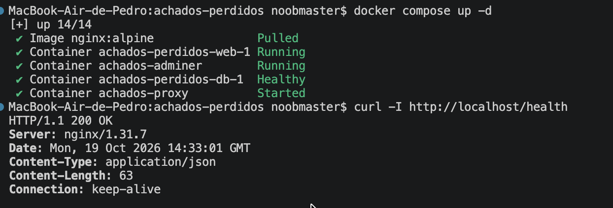

```console
$ docker compose up -d
[+] up 14/14
 ✔ Image nginx:alpine                    Pulled
 ✔ Container achados-perdidos-web-1      Running
 ✔ Container achados-adminer             Running
 ✔ Container achados-perdidos-db-1       Healthy
 ✔ Container achados-proxy               Started

$ curl -I http://localhost/health
HTTP/1.1 200 OK
Server: nginx/1.31.7
Date: Mon, 19 Oct 2026 14:33:01 GMT
Content-Type: application/json
Content-Length: 63
Connection: keep-alive
```

Com o proxy no ar, a aplicação passa a ser acessada na porta 80, sem o `:8080`.
O cabeçalho `Server: nginx/1.31.7` mostra que quem responde é o Nginx, e o
`Content-Type: application/json` com 63 bytes vem do Flask. O proxy repassou a
requisição para o `web:5000` e devolveu a resposta ao cliente.

O resumo `up 14/14` soma os recursos do compose usado nos bônus, que tem mais
serviços que o arquivo principal.

## Fechamento

As 17 capturas cobrem o ciclo do ambiente: build e subida, health check,
cadastro e leitura de itens, logs, persistência com volumes, remoção com
`down -v`, inspeção de rede e imagens, e os três bônus (Adminer, backup e
Nginx). A numeração dos arquivos acompanha a ordem dos testes, então cada seção
pode ser conferida direto no terminal.
